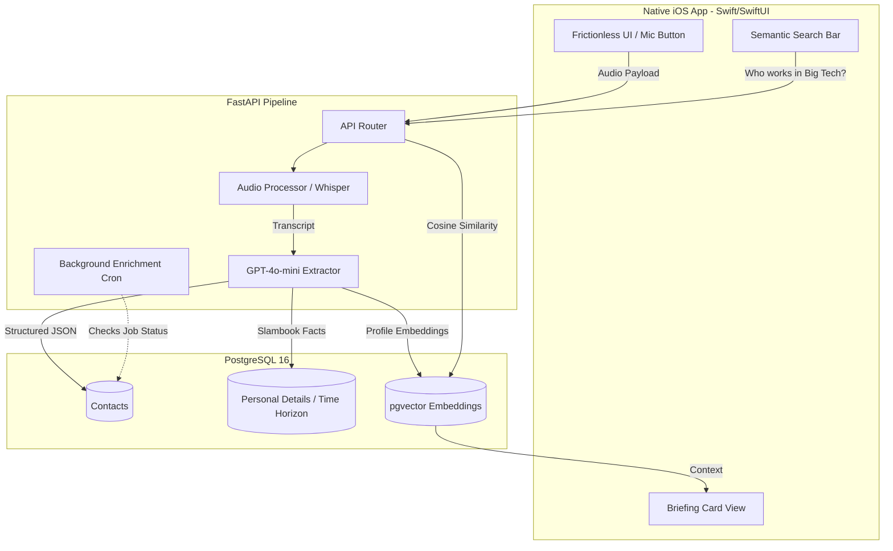

# Dex: The Intelligent Personal CRM

Dex is an AI-powered relational engine that transforms unstructured voice notes into a structured, temporal CRM, ensuring you never fumble an icebreaker again.

[Architecture](#architecture) · [UI Mockups](#)

## Overview

Networking decays over time. Professionals and founders struggle to recall critical personal details—such as a connection's spouse, children, or current company—months or years after an initial meeting. Existing CRM tools require tedious manual data entry, which creates friction and reduces adoption. Dex solves this by combining a frictionless voice-capture interface with an LLM-driven extraction pipeline and passive background enrichment, surfacing the exact context you need 5 minutes before your next meeting.

## Key Results

- **Frictionless Capture**: Reduced post-meeting data entry from minutes of manual typing to a 30-second unstructured voice dump, achieving high-fidelity structured data extraction.
- **Semantic Retrieval**: Enabled natural language queries across the contact graph (e.g., "Who do I know in aviation logistics?"), utilizing vector embeddings for intent-based routing.
- **Dynamic Context Surfacing**: Structured relationship data hierarchically based on temporal relevance (Short, Medium, and Long-Term horizons) to prevent information overload during pre-meeting prep.

## Key Features

- **Voice-to-Graph Extraction**: A FastAPI backend leverages Whisper and GPT-4o-mini to parse unstructured audio, identify entities, and assign temporal tags before routing data into PostgreSQL.
- **The Briefing Card**: A pre-meeting UI summarizing the last interaction, highlighting immediate hooks (active projects), and displaying foundational facts ("slambook" data).
- **Passive Career Radar**: Automated background enrichment pipeline to verify and update contact job titles and companies, generating organic nudges for outreach.
- **The Answer Machine**: pgvector-powered search bar replacing the traditional alphabetical index with an intent-driven contact discovery engine.

## Architecture

The system decouples a native iOS frontend from a heavy Python orchestration layer, allowing for rapid mobile UI iteration while centralizing the LLM and scraping logic.



## Design Decisions

| Decision | Rationale | Trade-off |
| :--- | :--- | :--- |
| **SwiftUI Native** | Unlocks thumb-zone ergonomics, native iOS Dictation/Mic APIs, and Lock Screen widgets for zero-friction capture. | Higher learning curve compared to React Native; locks MVP to Apple ecosystem. |
| **FastAPI Backend** | Python ecosystem provides the best tooling for LLM orchestration, async tasks, and data engineering. | Requires managing a separate deployed backend rather than relying purely on serverless/BaaS. |
| **pgvector** | Keeps relational data (contacts) and semantic embeddings (search) in the same database, simplifying transactions. | Slightly slower search at massive scale compared to a dedicated vector DB like Pinecone, but perfectly sufficient for a personal CRM. |

## Tech Stack

- **Frontend**: Swift, SwiftUI, AVFoundation
- **Backend**: Python, FastAPI, SQLAlchemy
- **Data & Storage**: PostgreSQL 16, pgvector
- **AI/ML**: OpenAI Whisper (Transcription), GPT-4o-mini (Entity Extraction & Routing)

## How It Works

1. **Capture**: The user taps a single button and records a voice memo summarizing a meeting.
2. **Extraction**: The backend transcribes the audio and extracts categorized facts (e.g., Category: Family, Value: Anushka, Time Horizon: Long-term).
3. **Storage**: Data is normalized into relational tables, and a synthesized profile embedding is updated in pgvector.
4. **Retrieval**: When opening a contact, the API serves a prioritized briefing card. When searching via natural language, the API routes the query through vector similarity search.

## Getting Started

> [!NOTE]
> This is a showcase repository. The proprietary LLM prompts, active backend services, and production deployment configurations are maintained in a private monorepo.

### Prerequisites

- iOS 17.0+ (Simulator or Physical Device)
- Python 3.11+
- PostgreSQL 16 with pgvector extension installed

### Project Structure

```plaintext
Dex-showcase/
├── docs/
│   ├── architecture-diagrams/
│   ├── database-schema.md
│   └── api-contracts.md
├── frontend-scaffold/
│   └── App/
│       └── DexApp.swift (Structural skeleton)
├── backend-scaffold/
│   └── main.py (API routing skeleton)
└── README.md
```

## Status and Contributions

This is an active development project designed for personal use and portfolio demonstration. Public contributions are not currently accepted.
