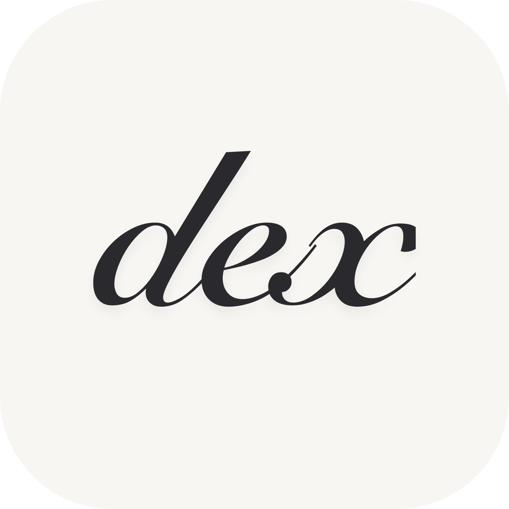
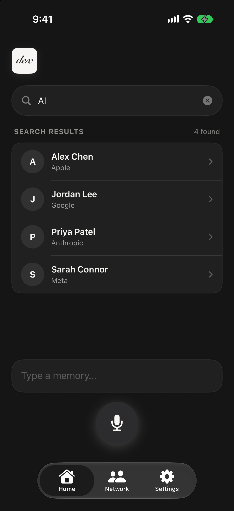
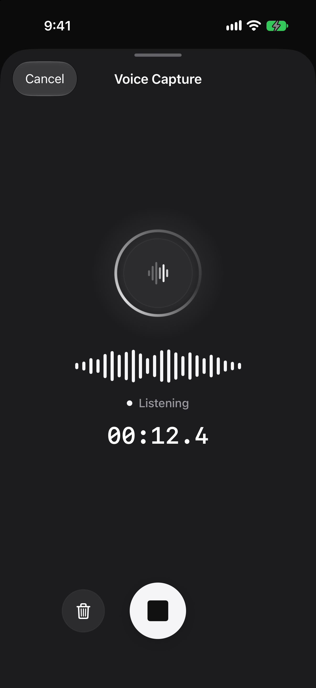
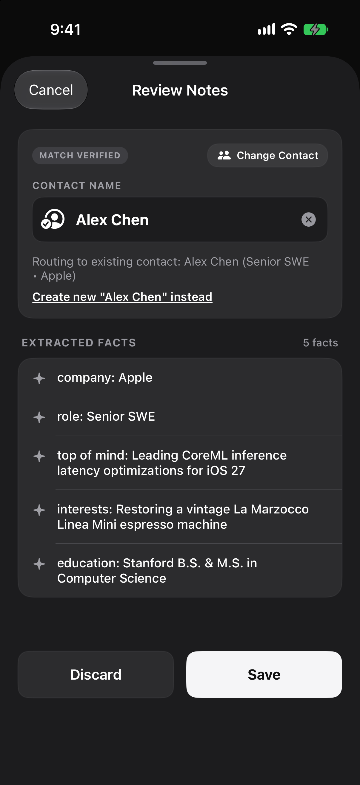
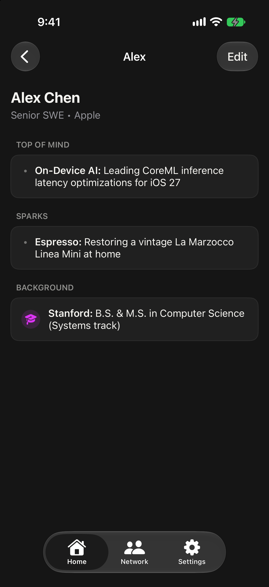
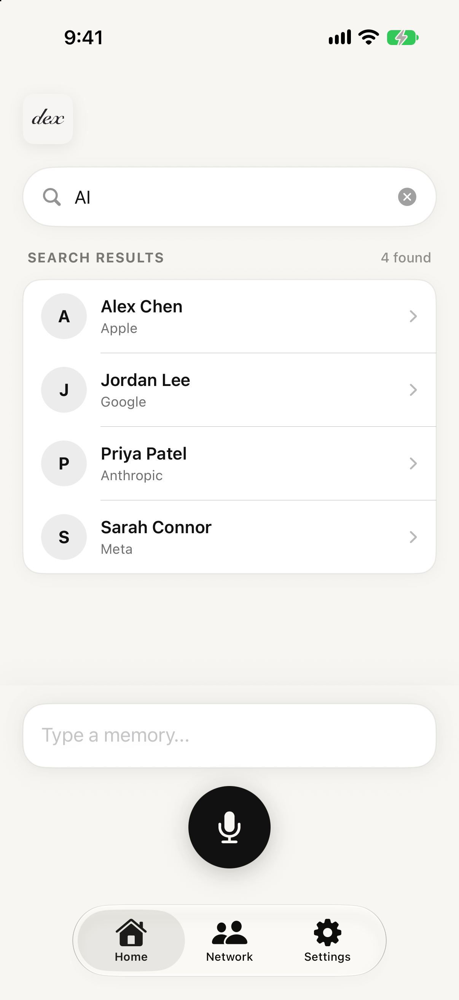
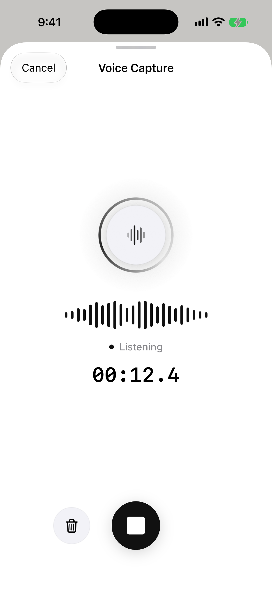
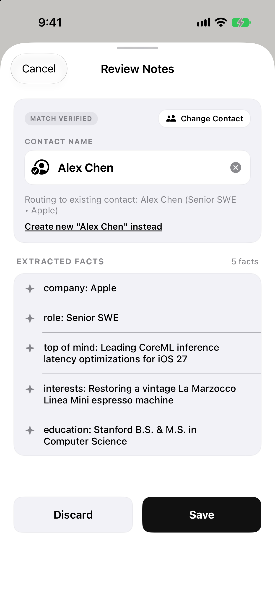
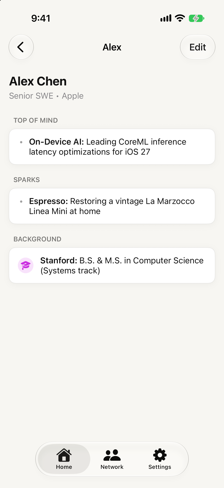
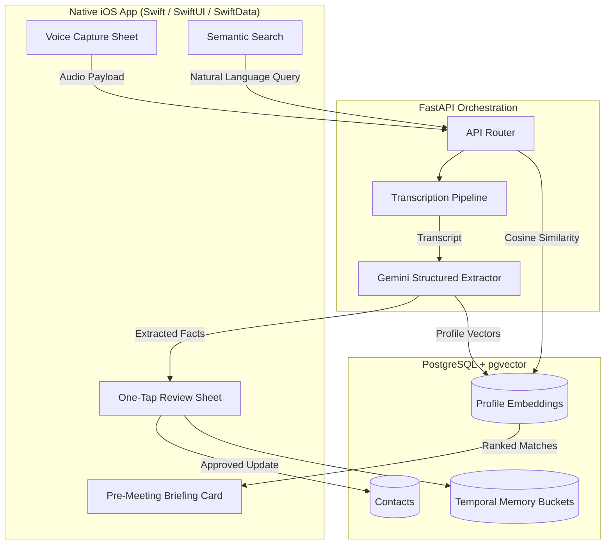

# Dex | The AI Personal CRM

<p align="center">
  
</p>

**Dex** is an intelligent iOS personal CRM and relationship memory engine that transforms 30-second unstructured voice notes into structured, searchable contact context.

**[Live Product Page (`dex.saaryan.com`)](https://dex.saaryan.com)** · **[Product Preview](#app-preview)** · **[Architecture](#architecture)** · **[Local Development](#local-development)**

---

## Overview

Meaningful relationships fade when context gets buried in scattered notes and manual CRM forms. Dex replaces data entry with natural speech: speak casually after a meeting or coffee, verify extracted facts with one tap, and walk into your next conversation with immediate context surfaced five minutes beforehand.

This repository hosts the standalone Next.js product showcase at [`dex.saaryan.com`](https://dex.saaryan.com), built in monochrome Warm Cream and Obsidian to mirror the native iOS app alongside architectural starter scaffolds for the mobile client and extraction backend.

---

## App Preview

Real iOS Simulator captures dynamically adapt inside [`components/device-frame.tsx`](components/device-frame.tsx) as the site toggles between **Obsidian (Dark)** and **Warm Cream (Light)** modes.

<table>
  <tr>
    <td align="center"><strong>Semantic Search</strong></td>
    <td align="center"><strong>Live Voice Capture</strong></td>
    <td align="center"><strong>One-Tap Verification</strong></td>
    <td align="center"><strong>Contact Briefing</strong></td>
  </tr>
  <tr>
    <td width="25%"></td>
    <td width="25%"></td>
    <td width="25%"></td>
    <td width="25%"></td>
  </tr>
  <tr>
    <td width="25%"></td>
    <td width="25%"></td>
    <td width="25%"></td>
    <td width="25%"></td>
  </tr>
</table>

---

## Product Pillars

- **Voice to CRM Capture**: Open the thumb-zone voice sheet, speak naturally about anyone, and convert unstructured audio into clean structured contact updates in under 30 seconds.
- **Human-in-the-Loop Review**: Automatic contact matching prevents duplicates and presents every extracted fact on a confirmation sheet before anything saves.
- **Temporal Memory Graph**: Organizes relationship details by time horizon (`Top of Mind`, `Context`, `Sparks`, and `Background`) so immediate priorities always sit above foundational bio context.
- **Offline-First Reliability**: Voice recordings and local relationship memory remain accessible on-device between flights or weak signal and sync automatically when online.
- **Semantic Recall**: Ask in plain English by company, topic, or half-remembered conversation detail instead of hunting through alphabetical folders.

---

## Showcase Website Stack

- **Framework**: Next.js 16 (App Router, `output: "export"` static generation) + React 19 + TypeScript 5
- **Styling & Theme**: Tailwind CSS v4 with a custom Warm Cream (`#F7F6F2`) / Obsidian (`#0A0A0A`) palette synced via `next-themes`
- **Motion & Interaction**: Framer Motion scroll/reveal primitives, custom magnetic cursor & link physics, and theme-aware iPhone hardware device frames
- **SEO & Metadata**: Full Open Graph and Twitter Card metadata, Schema.org `SoftwareApplication` (`BusinessApplication`, `iOS`) JSON-LD in [`app/layout.tsx`](app/layout.tsx), plus static [`app/sitemap.ts`](app/sitemap.ts) and [`app/robots.ts`](app/robots.ts)
- **Deployment**: Static export configured for Vercel with strict security headers in [`vercel.json`](vercel.json)

---

## Architecture

Dex decouples a native SwiftUI iOS client from a Python/FastAPI extraction and semantic indexing pipeline.



> [!NOTE]
> Production prompts, active iOS app sources, and backend deployment configuration live in private repositories. `frontend-scaffold/` and `backend-scaffold/` in this repo contain structural reference stubs alongside the live marketing showcase application.

---

## Project Structure

```plaintext
dex-showcase/
├── app/
│   ├── globals.css                # Monochrome Warm Cream & Obsidian design tokens
│   ├── layout.tsx                 # Global Metadata, JSON-LD schema, theme & chrome shell
│   ├── page.tsx                   # Static landing entrypoint
│   ├── robots.ts                  # Robots.txt route for static export
│   └── sitemap.ts                 # Sitemap XML generator for https://dex.saaryan.com/
├── components/
│   ├── cursor.tsx                 # Desktop custom pointer indicator
│   ├── device-frame.tsx           # Titanium iPhone mockup synced to Light/Dark themes
│   ├── dex-landing.tsx            # Hero preview switcher, capture flow, briefings & security
│   ├── footer.tsx                 # Minimal footer with attribution and social links
│   ├── magnetic-link.tsx          # Subtle pointer-following CTA wrapper
│   ├── navbar.tsx                 # Cross-property header (AS. / Dex) & anchor menu overlay
│   ├── page-transition.tsx        # Reduced-motion-safe page reveal wrapper
│   ├── reveal-text.tsx            # Masked word-by-word display headline motion
│   ├── theme-provider.tsx         # next-themes configuration
│   └── theme-toggle.tsx           # Warm Cream / Obsidian toggle control
├── lib/
│   └── use-hydrated.ts            # SSR-safe hydration hook via useSyncExternalStore
├── public/
│   ├── *-dark.png / *-light.png   # Real iOS Simulator captures for Light & Dark modes
│   ├── dex-logo.png               # App wordmark badge
│   ├── grid.svg                   # Subtle menu background texture
│   ├── og-image.jpg               # 1200x630 Open Graph / Twitter preview card
│   └── images/dex-icon-*.png      # Adaptive light/dark browser icons
├── backend-scaffold/
│   └── main.py                    # FastAPI structural route outline
├── frontend-scaffold/
│   └── App/DexApp.swift           # SwiftUI starter reference
├── instrumentation-client.ts      # Early client bootstrap & extension error guard
├── next.config.ts                 # Static export configuration
├── package.json
└── vercel.json                    # Security headers
```

---

## Local Development

```bash
# Install dependencies
npm install

# Run the Next.js development server (http://localhost:3000)
npm run dev

# Verify types, lint rules, and static production export (outputs to ./out)
npx tsc --noEmit
npm run lint
npm run build
```

---

## Author

Built by [Aaryan Sharma](https://www.saaryan.com) ([GitHub](https://github.com/sharmaaaryan4012) · [LinkedIn](https://www.linkedin.com/in/sharmaaaryan)). Public code contributions are not currently accepted.
